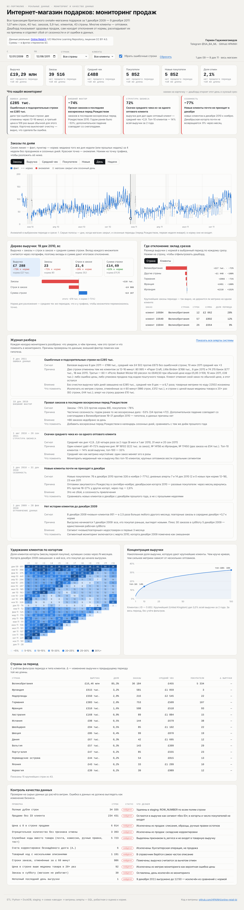
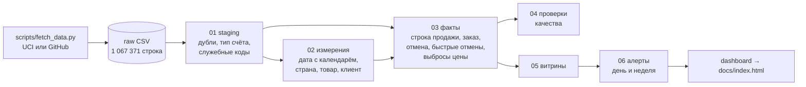

# Интернет-магазин подарков: мониторинг продаж и качества данных

**Дашборд:** https://hpainh.github.io/online-retail-bi/

BI-проект на **реальных данных**: все транзакции британского онлайн-магазина подарков за 1 декабря 2009 — 9 декабря 2011. Это 1 067 371 строка, 39,5 тыс. заказов, 5,9 тыс. клиентов и 43 страны; многие клиенты — оптовики. Пайплайн чистит сырые данные и строит хранилище и витрины. Мониторинг сам находит отклонения метрик, а разбор отделяет сбой от сезонности, от структуры бизнеса и от ошибки в данных.



**Источник:** [Online Retail II](https://archive.ics.uci.edu/dataset/502/online+retail+ii), UCI Machine Learning Repository, CC BY 4.0. Суммы — в фунтах стерлингов.

## Что нашёл мониторинг

| Тип | Находка | Как увидели | Причина и действие |
|---|---|---|---|
| Ошибка данных | Ошибочные и подозрительные строки на **£285 тыс.** | Выручка 9 дек 2011 — £198 тыс., средний чек £4 502 вместо £673 | 80 995 шт. (£168 тыс.) и 74 215 шт. (£77 тыс.) отменены клиентом через 12–16 минут; 60 корзин по £649,50 при цене кода £5,95 (×109). Такие строки исключаются из метрик |
| Внешний фактор | **−74%** заказов 19 дек 2010 | Дневной алерт по заказам и покупателям | Последнее воскресенье перед Рождеством (годом ранее −53%) плюс, вероятно, снегопады в Великобритании 16–21 дек 2010 — это гипотеза |
| Структура бизнеса | Средний чек **×2,9…3,8** за день | Четыре дневных алерта за 2 года | Один оптовый клиент даёт 41–72% выручки дня. Топ-10 клиентов — 14% всей выручки, топ-100 — 33% |
| Сезонность | Новые клиенты **−77%** в декабре | Дневные алерты 7 и 14 дек 2010, 23 ноя 2011 | Оптовики закупаются к Рождеству в сентябре–ноябре; декабрьская когорта 2010 возвращается в 9% случаев против 16–27% у других |
| Ограничение данных | 951 «новый» клиент в декабре 2009 | Повторные заказы ×3,7 к норме | Выгрузка начинается 1 дек 2009, поэтому старые клиенты выглядят новыми. Мониторинг сегментов включается с марта 2010 |

Всего 103 алерта (по дням и неделям). 69 приходятся на сезонные периоды: последние дни перед Рождеством, первую неделю января, недели с банковскими выходными. Из 34 алертов в обычные периоды 21 разобран в журнале; остальные помечены «не разобран» — это честный остаток для следующей итерации.

## Как устроено



**Очистка в staging** — что в сырых данных и что с этим делаем:
- 34 335 полных дублей строк — удаляем;
- счета-отмены (`C…`) и корректировки долга (`A…`) — отделяем от продаж;
- служебные коды (почтовые сборы, комиссия Amazon, ручные правки, тестовый товар) — помечаем и исключаем из товарной выручки;
- строки с ценой ≤ 0 и отрицательным количеством без отмены — исключаем.

**Схема «звезда»:**
- `fact_sale_line` — строка продажи;
- `fact_order` — заказ с сегментом: новый, повторный или без ID;
- `fact_cancellation` — строка отмены;
- `fast_cancel_match` — продажа и её отмена тем же клиентом за ≤ 60 минут;
- `price_outlier_line` — цена выше медианы товара в 20+ раз;
- измерения: `dim_date` (с календарём закрытий магазина), `dim_country`, `dim_product`, `dim_customer`.

**Витрины** (`marts/`):

| Витрина | Грейн | Для чего |
|---|---|---|
| `mart_daily` | день × группа стран × сегмент | выручка, исключённые строки, отмены, заказы |
| `mart_orders` | заказ | точные уникальные покупатели при любом фильтре |
| `mart_alerts` | день или неделя × срез × метрика | отклонения от нормы |
| `mart_cohorts` | когорта × месяц | удержание клиентов |
| `mart_customer_concentration` | топ-100 клиентов | доля выручки и накопленная доля |
| `mart_fast_cancellations`, `mart_price_outliers` | строка | разбор ошибочных строк |
| `mart_country_monthly` | месяц × страна | для BI-инструмента (DataLens, Redash) |
| `dq_results` | проверка | результаты проверок качества |

## Как работают алерты

1. **Норма** — медиана того же дня недели за 4 прошлые недели (для недельного шага — 4 прошлые недели). Дни закрытия, предрождественские дни и первая неделя января в норму не входят.
2. **Отклонение** считается как `ln(факт / норма)`.
3. **Шум** у каждого среза свой: робастная σ = 1,4826 × MAD. Оптовый бизнес шумный, поэтому фиксированный порог «±20%» дал бы десятки ложных срабатываний.
4. **Алерт** срабатывает, если |z| ≥ 4,5, отклонение ≥ 25% и в норме не меньше 10 заказов.
5. **Срезы:** весь магазин, группа стран, тип клиента. **Метрики:** выручка без ошибочных строк, заказы, средний чек, покупатели.
6. **Пропуски:** дни без заказов дополняются нулями, иначе «пропавший» день не попал бы в проверку.

Дашборд повторяет ту же логику для любой комбинации фильтров. Для одиночных срезов число аномалий сверено с SQL-витриной и совпадает.

**Разбор причины — дерево метрики:**

`Выручка = заказы × строк в заказе × средняя сумма строки`

Вклад каждого множителя считается через логарифм. Затем срез по странам или типам клиентов и таблица крупнейших заказов периода показывают, не держится ли отклонение на одном клиенте.

## Проверки качества данных

| Проверка | Строк |
|---|---:|
| Полные дубли строк | 34 335 |
| Продажи без ID клиента | 234 431 |
| Цена ≤ 0 в строке продажи | 6 014 |
| Отрицательное количество без отмены | 3 393 |
| Служебные коды вместо товара | 5 723 |
| Счета корректировки долга | 6 |
| Товарный код с несколькими описаниями | 1 191 |
| Строки, отменённые за ≤ 60 минут | 986 |
| Цена выше медианы товара в 20+ раз | 92 |
| Заказы в субботу (магазин не работает) | 30 |
| Неполный последний день выгрузки | 1 |

## Запуск

```bash
pip install -r requirements.txt
python scripts/fetch_data.py      # данные → data/online_retail_II.csv.gz
python etl.py                     # staging → звезда → проверки → витрины → алерты
python dashboard/build.py         # витрины → docs/index.html
```

`fetch_data.py` сначала скачивает официальный архив UCI (xlsx, нужен `openpyxl`). Если UCI недоступен, берёт тот же набор из R-пакета [onlineretail2](https://github.com/allanvc/onlineretail2) (нужен `pyreadr`). Скрипт сверяет число строк с эталоном 1 067 371.

Стек: Python, DuckDB (оконные функции, `QUALIFY`, медианы и MAD), HTML/SVG без библиотек.

---
Автор: Герман Гаджимагомедов · Telegram [@SA_BA_ML](https://t.me/SA_BA_ML) · GitHub [HPAINH](https://github.com/HPAINH)
